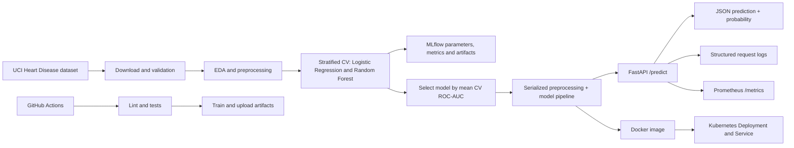

# Architecture

The training and serving code share a single scikit-learn pipeline, so missing-value imputation, one-hot encoding, scaling, and model inference are packaged together. This reduces training-serving skew. The holdout set is not used for model selection; model selection uses training-set cross-validation.
